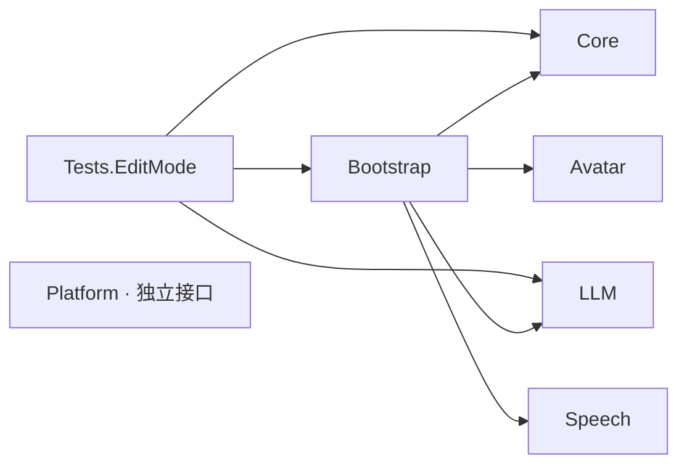

# FUMI-42 · Unity 工程与接口交接

## 打开工程

在 Unity Hub 使用 `6000.3.28f1` 打开仓库根目录，等待包恢复和编译。在 Project 窗口打开 `Assets/_Project/Scenes/BaselineDemo.unity` 并进入 Play。输入任意文字后点 **Send**，应看到三段模拟文字依次出现，结束时角色表情状态切换到 `calm`。再发送一次，在流式回复结束前点 **Cancel**，应显示 `Cancelled` 且停止输出。

## 版本与资产

工程基于安装包自带 Universal 3D 模板的项目设置。Unity `6000.3.28f1` 实际解析到 URP `17.3.0` 和 Unity Test Framework `1.6.0`，与内置 IMGUI、JSON 模块一起写入 manifest。传递包版本记录在 Unity 生成的 lockfile。使用 Visible Meta Files 与 Force Text。URP 资产关闭 HDR，示例相机不开启后处理。透明窗口实测由 FUMI-45 负责。

已核对本机解析到的 URP 与 Unity Test Framework 包 LICENSE，均标明适用于 Unity 依赖项目的 Unity Companion License。内置模块随编辑器提供，本工程未引入第三方角色、字体、语音和桌面原生插件。

## 程序集与公共契约

| 程序集 | 提供的契约 |
| --- | --- |
| `Xiaosu.Avatar` | `IAvatarAdapter`，加载、表情、动作、归一化口型 |
| `Xiaosu.CompanionAI.LLM` | FUMI-43 的 `ILLMProvider`、流式事件、解析器与 OpenAI 兼容实现 |
| `Xiaosu.CompanionAI.Speech` | `ITTSProvider`，返回 PCM 样本、采样率和声道数 |
| `Xiaosu.Core` | `IMemoryStore`、领蛋偏好、破壳档案、可撤销习惯及五种安全响应状态 |
| `Xiaosu.Platform` | `IDesktopWindow`，置顶与点击穿透的接入点 |
| `Xiaosu.Bootstrap` | Mock 演示和组合入口，引用 Core、Avatar、LLM、Speech |
| `Xiaosu.Tests.EditMode` | 独立编辑器测试，引用 Bootstrap、Core、LLM |



合同层不引用 UnityEngine。演示 UI 位于 Bootstrap，后续正式 UI 可独立分层。异步操作接收调用方的 `CancellationToken`；调用方关闭场景时先取消，完成收尾后释放资源。已有 LLM 契约以 `IsCancelled` 返回取消结果；其他异步 Mock 对取消抛出 `OperationCanceledException`。真实 LLM 事件消费者在接触 Unity 对象前应调度到 Unity 主线程。

破壳档案只包含角色标识、外观、人格与行为倾向。存储接口接受设置、档案和习惯，不提供写入原始对话或小镇经历的方法；内存 Mock 不落盘。安全 enum 只定义响应类别，检测、紧急提示与正式持久化隔离由后续实施与回归验证。

## Windows 干净检出复验

终端进入空目录，检出任务分支后，在仓库根目录执行。请让 EditMode 测试运行器退出进程并检查 XML；用例执行时不要额外传 `-quit`。

```powershell
git clone --branch feat/FUMI-42-unity-baseline https://github.com/ninjaz0/xiaosuchongban.git xiaosu-clean
Set-Location xiaosu-clean
$unity = 'C:\path\to\6000.3.28f1\Editor\Unity.exe'
$root = (Get-Location).Path
New-Item -ItemType Directory "$root\Logs" -Force | Out-Null
& $unity -batchmode -nographics -projectPath $root -runTests -testPlatform EditMode -testResults "$root\Logs\EditMode.xml" -logFile "$root\Logs\EditMode.log" | Out-Host
```

从 Test Runner 或结果 XML 核对流式完成、取消后无后续文本／表情、撤销习惯不改变初始人格三项用例。Windows x64 构建可在相同检出中执行：

```powershell
New-Item -ItemType Directory "$root\Build\Win64" -Force | Out-Null
& $unity -batchmode -quit -projectPath $root -buildWindows64Player "$root\Build\Win64\XiaosuMockDemo.exe" -logFile "$root\Logs\WindowsBuild.log" | Out-Host
```

启动构建产物验证场景。macOS 由队友按相同版本复验并独立记录。

## 当前验证状态

- **Windows x64，Unity `6000.3.28f1 (8f082d2fe476)`。** 从无 `Library` 的本地 Git 克隆导入，解析 URP 17.3.0 与 Test Framework 1.6.0。最终验证检出 `6029e91` 的批处理退出码为 0，EditMode 3／3 通过。
- **Windows x64 Player 构建成功。** 从上一个验证检出 `f477c64` 构建，编辑器在该检出中加载并升级 URP 设置。启动 `XiaosuMockDemo.exe`，输入文字并发送，界面从 `Streaming` 进入 `Complete`，显示完整模拟回复，表情从 `neutral` 切换为 `calm`。取消路径由 EditMode 用例覆盖。
- **FUMI-43 回归。** 独立回环模拟套件在 Windows x64、.NET 6.0.21 下 8／8 通过，取消后残留事件为 0。该套件独立于 Unity Editor。
- **待复验。** macOS、透明原生窗口、真实 Avatar／TTS／模型端点和实际安全响应均由对应任务验证。
